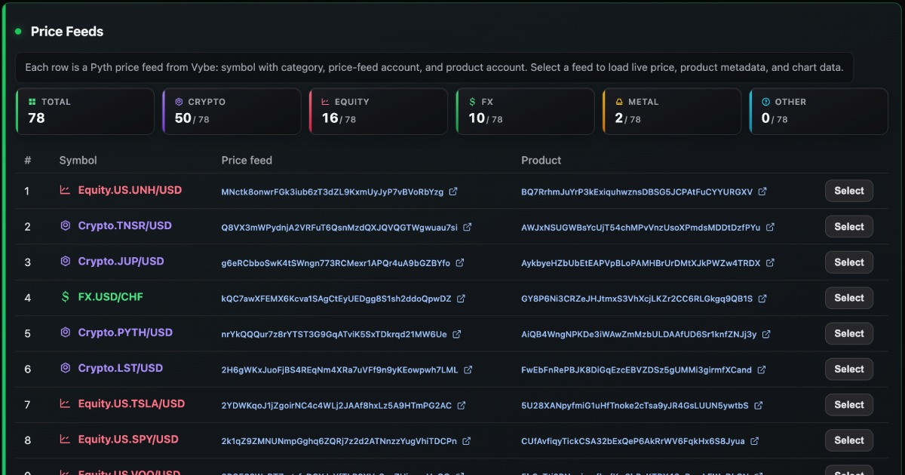

# Solana Pyth API

<p align="center">

[](https://solana-pyth-api.vybenetwork.com?utm_source=pyth-api-readme&utm_medium=referral)
[](https://github.com/vybenetwork/solana-pyth-api)
[](https://vybe.fyi/api-pricing?utm_source=pyth-api-readme&utm_medium=referral)
[](https://x.com/Vybe_Network)
</p>

Explore Solana Pyth API price feeds with the Vybe Solana API: live USD prices, OHLC candles, historical price series, product metadata and oracle tools.

Try the live demo: [`https://solana-pyth-api.vybenetwork.com`](https://solana-pyth-api.vybenetwork.com?utm_source=pyth-api-readme&utm_medium=referral)



---

## Endpoints used

| Vybe API | Local proxy |
|----------|-------------|
| `GET /v4/oracle/pyth/pricefeeds` | `GET /api/pyth/pricefeeds` |
| `GET /v4/oracle/pyth/pricefeeds/{priceFeedAddress}/price` | `GET /api/pyth/pricefeeds/:feed/price` |
| `GET /v4/oracle/pyth/pricefeeds/{priceFeedAddress}/candles` | `GET /api/pyth/pricefeeds/:feed/candles` |
| `GET /v4/oracle/pyth/pricefeeds/{priceFeedAddress}/price-ts` | `GET /api/pyth/pricefeeds/:feed/price-ts` |
| `GET /v4/oracle/pyth/products/{productAddress}` | `GET /api/pyth/products/:product` |

## Prerequisites

- **Node.js** ≥ 20
- A [Vybe Data API key](https://vybe.fyi/api-pricing?utm_source=pyth-api-readme&utm_medium=referral)

## Quick start

```bash
cp .env.example .env
# set VYBE_DATA_API_KEY in .env

npm install
npm run dev
```

Open http://localhost:3009

## Scripts

| Script | Purpose |
|--------|---------|
| `npm run dev` / `npm start` | Run the API + demo UI |
| `npm run build` | Compile TypeScript to `dist/` |
| `npm run typecheck` | Typecheck only |

## Related demos

- [Solana OHLC API](https://github.com/vybenetwork/solana-ohlc-api) — DEX token/market candles
- [Solana Trades API](https://github.com/vybenetwork/solana-trades-api) — historical trade data
- [Solana Balances API](https://github.com/vybenetwork/solana-balances-api) — wallet holdings

This repo focuses on **Pyth oracle** data only (not DEX OHLC/trades).
